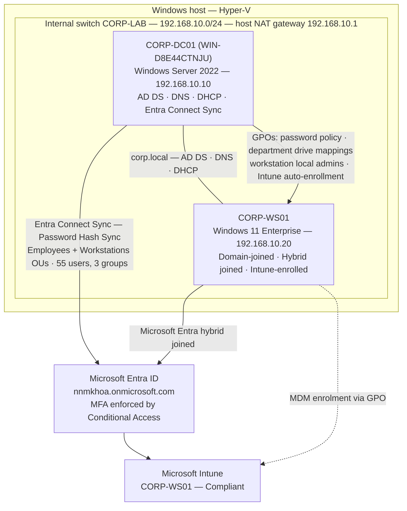

# Hybrid Enterprise Lab

A virtualized identity and infrastructure lab built in Hyper-V that simulates the environment of a small enterprise: an on-premises Active Directory domain (`corp.local`) synchronised to a Microsoft 365 / Microsoft Entra ID tenant, with a hybrid-joined Windows 11 workstation enrolled in Microsoft Intune. The lab was built in phases — on-premises foundation, endpoint join, cloud tenant and Conditional Access, then hybrid sync and device management — and each phase is documented in a runbook under `docs/`.

The goal is to practise the tasks used daily in Level 1 help desk / service desk roles: user account administration, group membership, password and multifactor authentication (MFA) issues, Domain Name System (DNS) / Dynamic Host Configuration Protocol (DHCP) checks, joining computers to a domain, Group Policy verification, device enrolment and compliance checks, and clear technical documentation.

## Architecture Overview

- **Hypervisor:** Hyper-V on a Windows Pro host
- **Lab network:** Hyper-V Internal switch `CORP-LAB` (192.168.10.0/24); the host acts as the gateway (192.168.10.1) with a Network Address Translation (NAT) rule for internet access
- **Domain controller:** CORP-DC01 (Windows hostname WIN-D8E44CTNJU), Windows Server 2022, static IP 192.168.10.10
- **Workstation:** CORP-WS01, Windows 11 Enterprise, static IP 192.168.10.20, domain-joined and Microsoft Entra hybrid joined
- **Domain:** corp.local — Active Directory Domain Services (AD DS), DNS, DHCP, Group Policy Objects (GPOs)
- **Cloud tenant:** Microsoft Entra ID (`nnmkhoa.onmicrosoft.com`) with Office 365 E5 and Enterprise Mobility + Security E5
- **Hybrid identity:** Microsoft Entra Connect Sync — Password Hash Synchronisation (PHS), synchronisation scoped to the Employees and Workstations organisational units (OUs): 55 users and 3 department groups
- **Device management:** Microsoft Intune — CORP-WS01 enrolled via GPO auto-enrolment and reporting **Compliant**

## Technologies

- **On-premises:** Windows Server 2022, Active Directory Domain Services, DNS, DHCP, Group Policy, Hyper-V
- **Endpoint:** Windows 11 Enterprise, domain join, `gpresult` / `dsregcmd` verification, mapped drives with item-level targeting
- **Cloud identity:** Microsoft 365, Microsoft Entra ID, Entra Connect Sync (Password Hash Synchronisation), MFA, Conditional Access
- **Device management:** Microsoft Intune (GPO auto-enrolment, compliance)
- **Documentation:** Markdown runbooks with verification screenshots (74 in `screenshots/`)

## What I built and why

- **A working small-company domain** (DC, DNS, DHCP, department OUs, groups, shares, and password/lockout policy) — the environment behind the most common Level 1 tickets: account lockouts, password resets, access requests, and "my drive is missing."
- **A domain-joined workstation verified end-to-end** — because "the policy didn't apply" is only answerable with evidence (`gpresult`, sign-in tests per department).
- **A cloud tenant with enforced MFA** — a Conditional Access policy taken from Report-only to On and proven in the sign-in logs, the same workflow behind everyday MFA tickets.
- **Hybrid sync and Intune enrolment** — one identity across on-premises and cloud (same password both places, verified), and a workstation whose enrolment and compliance an admin can check in a portal, which is the first question in most device tickets.
- **Runbooks for every phase, including the failures** — the SCP wizard error, the hybrid-join Kerberos failure (Event 420), and the missing Exchange-schema attribute are written up with their diagnoses, because documenting a fix clearly is itself a help desk skill.

## Progress Tracker

- [x] Phase 0: Environment setup, ISO downloads, and repo initialization
- [x] Phase 1: Domain controller, DNS/DHCP, AD OU structure, security groups, 54 provisioned users, and three GPOs (password/lockout, department drive mappings, workstation local admins)
- [x] Phase 2: Client workstation VM domain join and GPO verification
- [x] Phase 3: Microsoft 365 cloud tenant setup, MFA, and Conditional Access
- [x] Phase 4: Hybrid identity sync (Entra Connect), hybrid join, and Intune enrolment — CORP-WS01 Compliant
- [x] Phase 5: Final documentation — architecture diagram, runbooks, and this README

## Documentation

- [Phase 1 — On-premises foundation](docs/phase-1.md)
- [Phase 2 — Endpoint join](docs/phase-2.md)
- [Phase 3 — Microsoft 365 tenant, Entra ID, MFA and Conditional Access](docs/phase-3.md)
- [Phase 4 — Entra Connect Sync, hybrid join and Intune](docs/phase-4.md)

## Note on PowerShell

Test user accounts in this lab were populated in bulk from a CSV using a PowerShell provisioning script developed with AI assistance. PowerShell script authorship is not claimed; the hands-on work in this project is the Active Directory, DNS, DHCP, Microsoft 365, and Intune configuration and verification documented in the runbooks.
